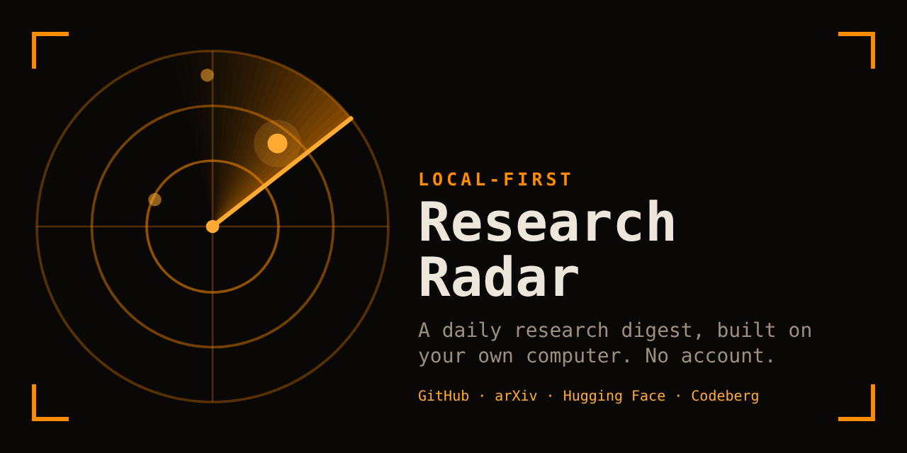

<p align="center"></p>

# research-radar

A daily research radar for the terminal that runs on your own computer.

You describe what you work on and what you are curious about. Research Radar looks at new GitHub repositories, arXiv papers, Hugging Face papers and models, and Codeberg repositories, keeps the few that fit your interests, and writes a short note about each one. The matching and the summaries are done by a local [Ollama](https://ollama.com) model, so there is no account, no API key for a language model, no usage limit, and your interests never leave your machine.

It does one thing: scan, filter and summarise. There is no chat.

## How a scan works

1. Each source fetches what is new since the last successful scan of that source.
2. Items you have already been shown are dropped.
3. An embedding model (`nomic-embed-text` by default, `embeddinggemma` also works) compares each item with the topic descriptions in your `interests.yaml`. This step needs no language model and cuts hundreds of items to a few dozen.
4. The best few, with a cap per topic and a cap overall, go to a chat model that writes one sentence on what the item is, one on why it fits, and a recommendation: install, read, watch or skip.
5. The result is saved as a markdown note, `notes/YYYY/MM/YYYY-MM-DD.md`, and shown in the terminal interface.
6. A digest of the day is written as a web page and, if you turned it on, sent to you by email or Telegram (see below).

The chat model only rewrites the text it is given (a README, an abstract). Links, star counts, licenses and dates come from the source's own fields, never from the model. If a topic has nothing good, the note says so instead of padding.

If Ollama is not running, a scan is a keyword preview: it shows items matched by keywords, described with the first sentence of their own text, and saves and sends nothing. Start Ollama and scan again; the next scan covers the same window.

## Install

You need Python 3.10 or newer and [Ollama](https://ollama.com/download). When the Ollama installer asks you to sign in, you can choose "No thanks, I'll use Ollama locally".

### Windows

Download the repository (the green Code button, Download ZIP, then unpack it) or clone it, open PowerShell in the folder and run:

```
powershell -ExecutionPolicy Bypass -File .\install.ps1
```

It asks no questions. It checks that Python is 3.10 or newer, creates a Python environment in `.venv` with Research Radar in it, creates your data folder with a starter `interests.yaml` (an existing one is never overwritten), and puts a Research Radar icon on the desktop. At the end it checks that Ollama is installed and running and that the two models a scan uses are downloaded. Anything missing is listed under **Before you start**, with the command that fixes it. These checks only warn: the program is installed either way. Run the script again after moving the folder.

The commands below then live in `.venv\Scripts\radar.exe`, for example `.venv\Scripts\radar.exe doctor`.

### Other systems

```
git clone https://github.com/HEX-1000/research-radar
cd research-radar
python3 -m venv .venv
. .venv/bin/activate
pip install -e .
radar init
```

### The models

A scan uses two local models: an embedding model that matches items with your topics, and a chat model that writes the short notes.

```
ollama pull nomic-embed-text
ollama pull qwen3.5:9b
```

Any chat model works. If `chat_model` is empty in your settings, the first installed non-embedding model is used. A 7B to 9B model is enough, because it only summarises short texts. You do not have to remember any of this: the interface and `radar doctor` name the exact `ollama pull` command for whatever is missing.

## First run

Open Research Radar from the desktop icon, or run `radar`.

The first thing to do is to describe your own interests. `radar init` copied an example `interests.yaml` with two topics, "Local-first AI tools" and "Geospatial machine learning". While those examples are unchanged, the interface says so, does not start a scan by itself, and `e` opens the file in an editor. Replace the topics with your own, and write each description the way you would explain it to a colleague: what you work on, which tools you use, what you want to hear about. The better the description, the better the matching. Save the file and press `s`: the interface reads the file again before every scan, so it can stay open while you edit. The file documents every setting.

If a later edit breaks the file (one wrong indent is enough), scans go on with the last copy that could be read, which is kept in `state/interests.last-good.yaml`. Until you fix the file, the digest page, the email, the Telegram message, the interface and `radar doctor` say which line to look at.

A topic you add or edit later does not start empty. The next scan looks back `first_run_days` for that topic alone, once, and says so ("Looked back for: ..."). Items you have already been shown are not shown again.

The top bar has a dot next to "ollama". Green means a scan can use both models. Amber means a model is missing and red means Ollama is not reachable; a notice then says what to do. Without Ollama, pressing s gives a keyword preview: the items are listed under the day with a "preview" mark, nothing is saved or sent, and votes are off for them. The interface does not start one by itself.

```
radar init      # creates ~/.research-radar/interests.yaml from the example
radar doctor    # checks Ollama and every source from your machine (--local: Ollama only)
radar           # opens the terminal interface
radar shortcut  # Windows: puts an icon on the desktop (install.ps1 already did)
radar label     # says whether recent candidates fit your topics, see Labelling
radar replay    # shows what each bar would have kept, missed and let through
radar update    # installs a newer version now, see Updates
radar schedule on   # Windows: a daily scan without opening the app, see Scheduling
```

To keep your data somewhere else, set `RADAR_HOME` or pass `--home`.

## The terminal interface

| Key | Action |
| --- | --- |
| `s` | scan now |
| `+` / `-` | mark the selected item useful or not useful (press again to clear) |
| `o` | open the link in your browser |
| `d` | open the digest page of the day you are looking at |
| `[` / `]` | older day / newer day |
| `e` | open `interests.yaml` in an editor (Notepad on Windows) |
| `f1` or `?` | all keys, the version, and where your files are |
| `q` | quit |

On launch it catches up automatically if any source has not been scanned today (`auto_scan_on_launch`), unless Ollama or the embedding model is missing or the example topics are still in place. Votes are kept and nudge later rankings: items that look like ones you marked `+` move up, items that look like ones you marked `-` move down. This is a simple heuristic, not a trained model. Votes are stored in `state/radar.db`; an older `feedback.json` is imported into it by the first scan or vote.

## Labelling and replay

`radar label` asks about candidates of the last 14 days (`--days N`), one at a time: the ones nearest to a topic's bar, taking one item from each topic in turn. It needs `state/radar.db`, so run a scan first. Answer `y` (it fits this topic), `n` (it does not), a number (it fits that topic instead), `l` (a lure: cracked software or the like), `o` (open the link), `s` (skip) or `q` (quit). Every answer is saved at once. Items you already labelled or voted on are not asked about again, except a GitHub repository whose only signal is a `-` vote: it is asked about too, with `vote -` in its header, because a `-` does not say whether it is a lure.

`radar replay` reads those labels and your `+` and `-` votes (a vote counts as a label when the item has none) and prints, for each topic, how many labelled items each bar from 0.30 to 0.60 would have kept, let through as noise or missed. It scores them again against the current text of each topic, so it needs Ollama; without it, it uses the scores stored at scan time and says how many labels it left out. It does not suggest a value: choose `min_score` for a topic from the table. A lure counts as a "no" for every topic. It ends with how the trust check for small GitHub repositories fares on the repositories you labelled or marked `+`; a repository with only a `-` vote is left out there until you answer it in `radar label`. Under the table it names the repositories of "Others caught" and "Lures not caught" with the size, stars and followers of their first observation.

## A desktop icon (Windows)

```
radar shortcut
```

puts a Research Radar icon on your desktop (`install.ps1` does this for you). A double-click opens the terminal interface in Windows Terminal when it is installed (colors and borders look best there), or in the normal console otherwise. The icon carries the path of your data folder, so it works even when the `RADAR_HOME` variable is not visible to it. Run the command from the environment where you installed the program. To keep the icon on the taskbar, right-click it and choose Pin to taskbar. If you move the repository or rebuild the virtual environment, run `radar shortcut` again.

## The daily digest

The markdown note is the archive. The digest is the version you read: a page grouped by topic, the items worth acting on first (try, read, watch), the ones the model marked "skip" folded into a short list at the end. It has a light and a dark theme and fits a phone screen.

Every scan writes it to `digests/YYYY-MM-DD.html` in your data folder. Press `d` in the terminal interface to open it in your browser. Email and Telegram are optional and off by default. Turn them on in the `delivery` section of `interests.yaml`.

Secrets are never written to that file. It names an environment variable, and the secret lives there.

**Email.** Any SMTP server works. For Gmail, turn on two-step verification, create an app password, and put it in the variable named by `password_env` (`RADAR_SMTP_PASSWORD` by default). The mail has an HTML part and a plain text part.

**Telegram.** Create a bot with [@BotFather](https://t.me/BotFather), put its token in `RADAR_TELEGRAM_TOKEN`, open the bot, press Start and send it any text. Then run `radar telegram-chat` to see your chat id and put it in `delivery.telegram.chat_id`. A digest arrives as a header (with sound) and one silent message per item, each with `+` and `-` buttons. A vote is recorded at the next scan; after that the button shows a check mark. Votes count like the ones given in the interface, and the last press on an item wins.

```
radar send --test       # one short test message through each enabled channel
radar send --dry-run    # write the page and show what would be sent, send nothing
radar send              # send whatever has not been delivered yet
radar send --date 2026-10-27   # send a whole past day again
```

A scan sends only the items that are new. Each channel keeps its own record of what it has delivered, so an item is never sent twice, and one that failed to send (the computer was offline, the server was down) is retried by the next scan for `retry_days` days. A failed send never fails the scan. `radar doctor` checks the login and the bot as well.

## Scheduling (optional)

The app has no timer and no background process of its own. Because every scan starts from the last successful run of each source, nothing is lost if the computer was off for a few days: the next scan collects the whole gap, up to `max_catchup_days`.

On Windows, one command sets up a daily scan in the Task Scheduler:

```
radar schedule on              # every day at 19:45
radar schedule on --at 07:30   # another time
radar schedule status          # next run, last run and how it ended
radar schedule off
```

The task runs while you are logged on. It needs no password and no administrator rights, opens no window, and starts as soon as possible after a missed time (the computer was off or asleep) once there is a network connection. The scan sends your digest by email or Telegram if you turned those on. What it did is written to `logs/scan.log` in your data folder.

If Ollama or the embedding model is not ready, the scheduled scan waits briefly for Ollama and then does not scan at all, instead of a keyword preview that counts the day as read. `radar schedule status` then says so, and the next scan collects what was missed. If you move the folder or rebuild `.venv`, run `radar schedule on` again.

Without the Task Scheduler, `radar scan` does the same work from the command line. On Linux or macOS, `radar schedule on` prints a cron line to use, for example `45 19 * * * ... scan --scheduled`. Useful flags of `radar scan`: `--days N` to look back a fixed number of days, `--no-llm` for a keyword preview without Ollama (nothing is saved or sent), `--explain` to print the scores of the top 30 candidates so you can tune `min_score`, and `--scheduled` (log to file, skip when Ollama is not ready) for schedulers.

## Sources and their limits

| Source | What it reads | Notes |
| --- | --- | --- |
| `github` | new repositories from the search API, per query in your topics | Without a token the search API allows about 10 requests a minute, with one about 30. Set the environment variable `GITHUB_TOKEN` to a token with no scopes. GitHub has no official trending API, so "new" means created since the last scan. Repositories you were shown earlier that gained many stars are reported once as "rising"; one that was deleted since is named once in the notes. Repositories whose name, description or topics offer cracked software, keygens or license keys are dropped, and so are those whose name and topics carry two different selling endings (download, free, activated, crack, license) on one stem, such as `x-download` with `x-free`. A repository under 200 KB is held back for 7 days and then checked again when it has at least 10 stars and an owner with 2 followers or fewer, or fewer than 10 stars and an owner with no followers; it is named in the notes without a link. Set `trust_check: false` under `settings` to turn this off. |
| `arxiv` | the official Atom API, one query per topic | Requests are spaced about 3 seconds apart, as arXiv asks. |
| `huggingface-papers` | the daily papers list for each day in the window | |
| `huggingface-models` | currently trending models | Off by default. Matches on tags only, so it is the noisiest source. |
| `feeds` | Atom and RSS feeds that a topic lists under `watch` or `feeds: urls:` | Reads nothing until a topic lists a feed, see below. |
| `forgejo` | repository search on Codeberg or any Gitea or Forgejo server | Since November 2026 Codeberg refuses searches without an access token (HTTP 429), so it needs a free account and a token, see below. Add servers under `sources.forgejo.instances`. |

**A Codeberg token.** Create a free account on [codeberg.org](https://codeberg.org), open Settings, Applications, and generate a token with access to public repositories only and the permission "repository: Read". Put it in the environment variable `RADAR_CODEBERG_TOKEN`. On Windows, in PowerShell:

```
[Environment]::SetEnvironmentVariable("RADAR_CODEBERG_TOKEN", "your token", "User")
```

`"User"` stays as written: it means your Windows account. Open Research Radar again afterwards, so it sees the variable. `radar doctor` says whether the token is used. The token is sent only to Codeberg. For another Forgejo or Gitea server, name its variable under `sources.forgejo.token_env`, for example `git.example.org: MY_GITEA_TOKEN`. Without a token the scan asks Codeberg once, skips it when it refuses, and collects the gap once a token is set, up to `max_catchup_days`.

**A watch list.** Under a topic, `watch` names things you want to hear about whenever they change, without a score bar:

```yaml
topics:
  - name: Decompilation tools
    description: ...
    watch:
      - NationalSecurityAgency/ghidra                        # GitHub owner/name: its releases feed
      - https://github.com/matt-kempster/m2c/commits.atom    # or any Atom or RSS feed
    feeds:
      urls: [https://example.org/blog/feed.xml]              # posts, scored like any other item
```

`owner/name` means the releases feed of that repository. A repository without releases has an empty releases feed, so watch its `commits.atom` instead; `radar doctor` says "no entries" for such a feed and shows the address to use. A watched feed on github.com is named `owner/name`, and its items are releases (`releases.atom`), commits (`commits.atom`) or, for any other GitHub feed, articles; another feed keeps its own title. A watched feed shows at most one item per scan, its newest entry, and adds "and 3 earlier commits since 2 October" (releases, commits or entries, by kind) when more came in. These items skip the bar and are not counted against `max_items` or `max_per_topic`. An entry with under 200 characters of text gets a fixed note instead of one from the model: "New release v1.2 of owner/name.", "New commit to owner/name: the commit message." or "New entry in Blog title: the post title." Posts from `feeds: urls:` go through scoring and the caps like papers and repositories. A topic that gains a watch entry looks back `first_run_days` days for it, like any edited topic. A feed larger than 2 MB, or one that declares XML entities, is skipped with a warning, and a feed that fails keeps the window of the `feeds` source open until it works.

Each source is a small module in `src/research_radar/sources/`. A source takes the date window and your topics and returns a list of items, so adding one is a short file. Pull requests are welcome.

## Updates

When the terminal interface opens, it reads one small file from this repository on GitHub, `src/research_radar/__init__.py`, and compares the version in it with yours. If the version on GitHub is newer, it installs the new files and starts the new version. You see one line in the console and a notice in the app that lists what changed, taken from `CHANGELOG.md`.

- A `git clone` of this repository is updated with `git pull --ff-only`, unless a tracked file has local edits. Then it skips the update and tells you. A clone of a fork is not updated.
- A folder unpacked from the ZIP (what `install.ps1` sets up) is updated from the repository ZIP. Every Python file is checked for syntax errors before anything is written.
- New or changed dependencies are installed with pip before any code changes. If pip fails, nothing changes.
- Your data folder is never touched, and neither are `.venv`, `.git` or personal files kept at the top of the folder. Files an update replaces are copied to `.update_backup/` first. Nothing is deleted.
- A plain `pip install` of the package (the code in site-packages) is not changed; the app shows the command that updates it.
- If GitHub cannot be reached, nothing happens and the app starts as usual.

To turn it off, add `auto_update: false` under `settings` in `interests.yaml`. You can run the check yourself with `radar update`. A scheduled `radar scan` never updates anything.

Updating means running code downloaded from this repository, so the repository owner's GitHub account is trusted the same way it is when you first download the app. Versions before 0.2.0 have no update check. Run `git pull` or download the ZIP again once, and later updates come by themselves.

## Privacy

- Your interests file, notes, votes and history live in your data folder and are never sent anywhere.
- Network traffic goes to the sources above, to your local Ollama, and, when the interface opens, to GitHub for the update check: plain requests to `raw.githubusercontent.com` and `github.com` with nothing about you in them.
- Email and Telegram are off by default. If you turn one on, each digest (titles, links and short summaries, which show what you follow) is sent through your mail server or through Telegram. Nothing else leaves your machine.
- There is no telemetry.
- `.gitignore` excludes `interests.yaml`, `notes/`, `state/`, vote files and `.env`, so running the app from inside a clone cannot commit personal data by accident.

## Status

Version 0.3. The test suite covers the pipeline, ranking, notes, the digest, delivery, the interface, the first-run guidance, the update check, the daily task and every source parser. The five sources were checked against the live services with `radar doctor` and a real scan on the author's machine. Email and Telegram delivery are tested against fake servers only, so run `radar send --test` once after setting them up. The Windows installer and the update check are new in 0.2, and the daily task is new in 0.3. If a source, a channel, the installer or an update breaks, `radar doctor` or the console says why. Please open an issue with the output, and remove your email address and Telegram chat id from it first: `radar doctor` prints both. Questions and ideas go to [Discussions](https://github.com/HEX-1000/research-radar/discussions).

`min_score` depends on the embedding model. With `nomic-embed-text` the default of 0.55 is a starting point, and with `embeddinggemma` the best matches score lower (about 0.45 to 0.5), so 0.44 is a better start. Run `radar scan --days 3 --explain` to see the scores and the bar of each topic, and set it for your own topics. A topic can have its own `min_score` and `max_per_topic` in `interests.yaml`; they replace the values under `settings` for that topic. An item goes to the topic whose bar it clears by the most, and `max_per_topic: 0` hides a topic while its items are still scored.

## Development

```
pip install -e ".[dev]"
pytest
```

Tests run offline with fake sources and a fake Ollama. GitHub runs them on Windows and Linux for every push (`.github/workflows/tests.yml`). Because a new version number reaches every user who has automatic updates on, add an entry to `CHANGELOG.md` and raise `__version__` only for a commit that passes.

## License

MIT. See `LICENSE`.
