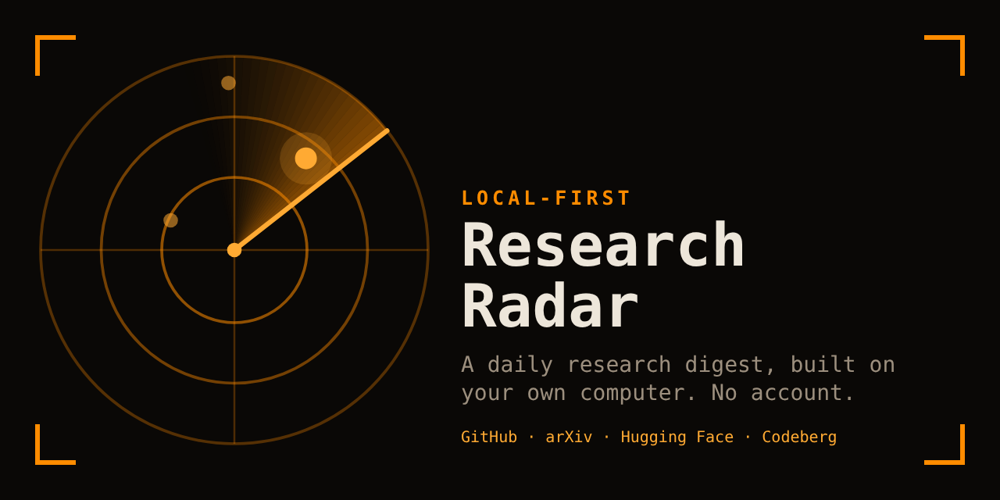

<p align="center"></p>

# research-radar

A daily research radar for the terminal that runs on your own computer.

You describe what you work on and what you are curious about. Research Radar looks at new GitHub repositories, arXiv papers, Hugging Face papers and models, and Codeberg repositories, keeps the few that fit your interests, and writes a short note about each one. The matching and the summaries are done by a local [Ollama](https://ollama.com) model, so there is no account, no API key for a language model, no usage limit, and your interests never leave your machine.

It does one thing: scan, filter and summarise. There is no chat.

## How a scan works

1. Each source fetches what is new since the last successful scan of that source.
2. Items you have already been shown are dropped.
3. An embedding model (`nomic-embed-text` by default, `embeddinggemma` also works) compares each item with the topic descriptions in your `interests.yaml`. This step needs no language model and cuts hundreds of items to a few dozen.
4. The best few, with a cap per topic and a cap overall, go to a chat model that writes one sentence on what the item is, one on why it fits, and a recommendation: install, read, watch or skip.
5. The result is saved as a markdown note, `notes/YYYY/MM/YYYY-MM-DD.md`, and shown in the terminal interface.
6. A digest of the day is written as a web page and, if you turned it on, sent to you by email or Telegram (see below).

The chat model only rewrites the text it is given (a README, an abstract). Links, star counts, licenses and dates come from the source's own fields, never from the model. If a topic has nothing good, the note says so instead of padding.

If Ollama is not running, a scan still works: items are matched by keywords and described with the first sentence of their own text. The note says so.

## Install

You need Python 3.10 or newer and [Ollama](https://ollama.com/download). When the Ollama installer asks you to sign in, you can choose "No thanks, I'll use Ollama locally".

### Windows

Download the repository (the green Code button, Download ZIP, then unpack it) or clone it, open PowerShell in the folder and run:

```
powershell -ExecutionPolicy Bypass -File .\install.ps1
```

It asks no questions. It checks that Python is 3.10 or newer, creates a Python environment in `.venv` with Research Radar in it, creates your data folder with a starter `interests.yaml` (an existing one is never overwritten), and puts a Research Radar icon on the desktop. At the end it checks that Ollama is installed and running and that the two models a scan uses are downloaded. Anything missing is listed under **Before you start**, with the command that fixes it. These checks only warn: the program is installed either way. Run the script again after moving the folder.

The commands below then live in `.venv\Scripts\radar.exe`, for example `.venv\Scripts\radar.exe doctor`.

### Other systems

```
git clone https://github.com/HEX-1000/research-radar
cd research-radar
python3 -m venv .venv
. .venv/bin/activate
pip install -e .
radar init
```

### The models

A scan uses two local models: an embedding model that matches items with your topics, and a chat model that writes the short notes.

```
ollama pull nomic-embed-text
ollama pull qwen3.5:9b
```

Any chat model works. If `chat_model` is empty in your settings, the first installed non-embedding model is used. A 7B to 9B model is enough, because it only summarises short texts. You do not have to remember any of this: the interface and `radar doctor` name the exact `ollama pull` command for whatever is missing.

## First run

Open Research Radar from the desktop icon, or run `radar`.

The first thing to do is to describe your own interests. `radar init` copied an example `interests.yaml` with two topics, "Local-first AI tools" and "Geospatial machine learning". While those examples are unchanged, the interface says so, does not start a scan by itself, and `e` opens the file in an editor. Replace the topics with your own, and write each description the way you would explain it to a colleague: what you work on, which tools you use, what you want to hear about. The better the description, the better the matching. Save the file and press `s`: the interface reads the file again before every scan, so it can stay open while you edit. The file documents every setting.

The top bar has a dot next to "ollama". Green means a scan can use both models. Amber means a model is missing and red means Ollama is not reachable; a notice then says what to do. Without Ollama a scan still works, but it matches by keywords only, so the interface does not start one by itself in that case.

```
radar init      # creates ~/.research-radar/interests.yaml from the example
radar doctor    # checks Ollama and every source from your machine (--local: Ollama only)
radar           # opens the terminal interface
radar shortcut  # Windows: puts an icon on the desktop (install.ps1 already did)
radar update    # installs a newer version now, see Updates
```

To keep your data somewhere else, set `RADAR_HOME` or pass `--home`.

## The terminal interface

| Key | Action |
| --- | --- |
| `s` | scan now |
| `+` / `-` | mark the selected item useful or not useful (press again to clear) |
| `o` | open the link in your browser |
| `d` | open the digest page of the day you are looking at |
| `[` / `]` | older day / newer day |
| `e` | open `interests.yaml` in an editor (Notepad on Windows) |
| `f1` or `?` | all keys, the version, and where your files are |
| `q` | quit |

On launch it catches up automatically if any source has not been scanned today (`auto_scan_on_launch`), unless Ollama or the embedding model is missing or the example topics are still in place. Votes are kept and nudge later rankings: items that look like ones you marked `+` move up, items that look like ones you marked `-` move down. This is a simple heuristic, not a trained model.

## A desktop icon (Windows)

```
radar shortcut
```

puts a Research Radar icon on your desktop (`install.ps1` does this for you). A double-click opens the terminal interface in Windows Terminal when it is installed (colors and borders look best there), or in the normal console otherwise. The icon carries the path of your data folder, so it works even when the `RADAR_HOME` variable is not visible to it. Run the command from the environment where you installed the program. To keep the icon on the taskbar, right-click it and choose Pin to taskbar. If you move the repository or rebuild the virtual environment, run `radar shortcut` again.

## The daily digest

The markdown note is the archive. The digest is the version you read: a page grouped by topic, the items worth acting on first (try, read, watch), the ones the model marked "skip" folded into a short list at the end. It has a light and a dark theme and fits a phone screen.

Every scan writes it to `digests/YYYY-MM-DD.html` in your data folder. Press `d` in the terminal interface to open it in your browser. Email and Telegram are optional and off by default. Turn them on in the `delivery` section of `interests.yaml`.

Secrets are never written to that file. It names an environment variable, and the secret lives there.

**Email.** Any SMTP server works. For Gmail, turn on two-step verification, create an app password, and put it in the variable named by `password_env` (`RADAR_SMTP_PASSWORD` by default). The mail has an HTML part and a plain text part.

**Telegram.** Create a bot with [@BotFather](https://t.me/BotFather), put its token in `RADAR_TELEGRAM_TOKEN`, open the bot, press Start and send it any text. Then run `radar telegram-chat` to see your chat id and put it in `delivery.telegram.chat_id`.

```
radar send --test       # one short test message through each enabled channel
radar send --dry-run    # write the page and show what would be sent, send nothing
radar send              # send whatever has not been delivered yet
radar send --date 2026-10-27   # send a whole past day again
```

A scan sends only the items that are new. Each channel keeps its own record of what it has delivered, so an item is never sent twice, and one that failed to send (the computer was offline, the server was down) is retried by the next scan for `retry_days` days. A failed send never fails the scan. `radar doctor` checks the login and the bot as well.

## Scheduling (optional)

The app has no timer and no background process. Because every scan starts from the last successful run of each source, nothing is lost if the computer was off for a few days: the next scan collects the whole gap, up to `max_catchup_days`.

If you want scans without opening the interface, `radar scan` does the same work from the command line.

On Windows, create a Task Scheduler task that runs `radar scan`, and on the Settings tab enable "Run task as soon as possible after a scheduled start is missed". On Linux or macOS, a cron line such as `0 19 * * * radar scan` works. Useful flags: `--days N` to look back a fixed number of days, `--no-llm` to skip Ollama, `--explain` to print the scores of the top 30 candidates so you can tune `min_score`.

## Sources and their limits

| Source | What it reads | Notes |
| --- | --- | --- |
| `github` | new repositories from the search API, per query in your topics | Without a token the search API allows about 10 requests a minute, with one about 30. Set the environment variable `GITHUB_TOKEN` to a token with no scopes. GitHub has no official trending API, so "new" means created since the last scan. Repositories you were shown earlier that gained many stars are reported once as "rising". |
| `arxiv` | the official Atom API, one query per topic | Requests are spaced about 3 seconds apart, as arXiv asks. |
| `huggingface-papers` | the daily papers list for each day in the window | |
| `huggingface-models` | currently trending models | Matches on tags only, so it is the noisiest source. |
| `forgejo` | repository search on Codeberg or any Gitea or Forgejo server | Add servers under `sources.forgejo.instances`. |

Each source is a small module in `src/research_radar/sources/`. A source takes the date window and your topics and returns a list of items, so adding one is a short file. Pull requests are welcome.

## Updates

When the terminal interface opens, it reads one small file from this repository on GitHub, `src/research_radar/__init__.py`, and compares the version in it with yours. If the version on GitHub is newer, it installs the new files and starts the new version. You see one line in the console and a notice in the app.

- A `git clone` of this repository is updated with `git pull --ff-only`, unless a tracked file has local edits. Then it skips the update and tells you. A clone of a fork is not updated.
- A folder unpacked from the ZIP (what `install.ps1` sets up) is updated from the repository ZIP. Every Python file is checked for syntax errors before anything is written.
- New or changed dependencies are installed with pip before any code changes. If pip fails, nothing changes.
- Your data folder is never touched, and neither are `.venv`, `.git` or personal files kept at the top of the folder. Files an update replaces are copied to `.update_backup/` first. Nothing is deleted.
- A plain `pip install` of the package (the code in site-packages) is not changed; the app shows the command that updates it.
- If GitHub cannot be reached, nothing happens and the app starts as usual.

To turn it off, add `auto_update: false` under `settings` in `interests.yaml`. You can run the check yourself with `radar update`. A scheduled `radar scan` never updates anything.

Updating means running code downloaded from this repository, so the repository owner's GitHub account is trusted the same way it is when you first download the app. Versions before 0.2.0 have no update check. Run `git pull` or download the ZIP again once, and later updates come by themselves.

## Privacy

- Your interests file, notes, votes and history live in your data folder and are never sent anywhere.
- Network traffic goes to the sources above, to your local Ollama, and, when the interface opens, to GitHub for the update check: plain requests to `raw.githubusercontent.com` and `github.com` with nothing about you in them.
- Email and Telegram are off by default. If you turn one on, each digest (titles, links and short summaries, which show what you follow) is sent through your mail server or through Telegram. Nothing else leaves your machine.
- There is no telemetry.
- `.gitignore` excludes `interests.yaml`, `notes/`, `state/`, vote files and `.env`, so running the app from inside a clone cannot commit personal data by accident.

## Status

Version 0.2. The test suite covers the pipeline, ranking, notes, the digest, delivery, the interface, the first-run guidance, the update check and every source parser. The five sources were checked against the live services with `radar doctor` and a real scan on the author's machine. Email and Telegram delivery are tested against fake servers only, so run `radar send --test` once after setting them up. The Windows installer and the update check are new in 0.2. If a source, a channel, the installer or an update breaks, `radar doctor` or the console says why. Please open an issue with the output.

`min_score` depends on the embedding model. With `nomic-embed-text` the default of 0.55 is a starting point, and with `embeddinggemma` the best matches score lower (about 0.45 to 0.5), so 0.44 is a better start. Run `radar scan --days 3 --explain` to see the scores and set it for your own topics.

## Development

```
pip install -e ".[dev]"
pytest
```

Tests run offline with fake sources and a fake Ollama.

## License

MIT. See `LICENSE`.
